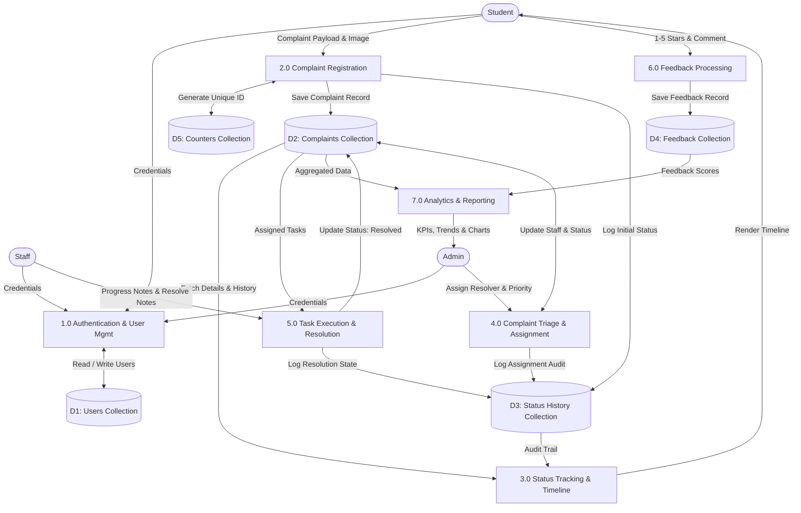
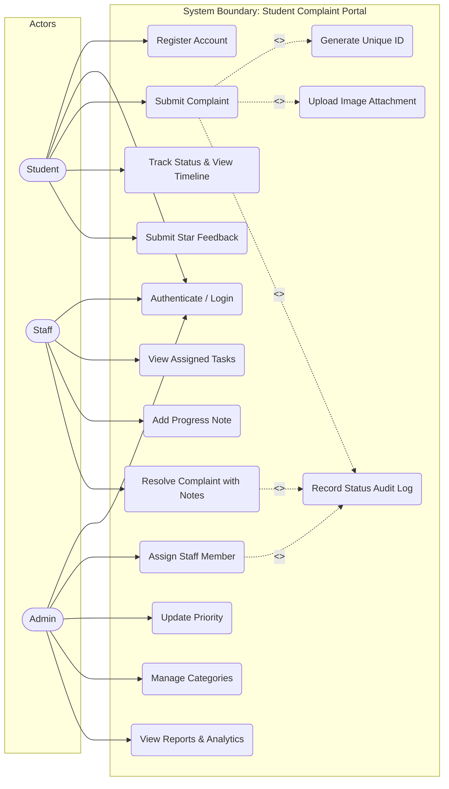
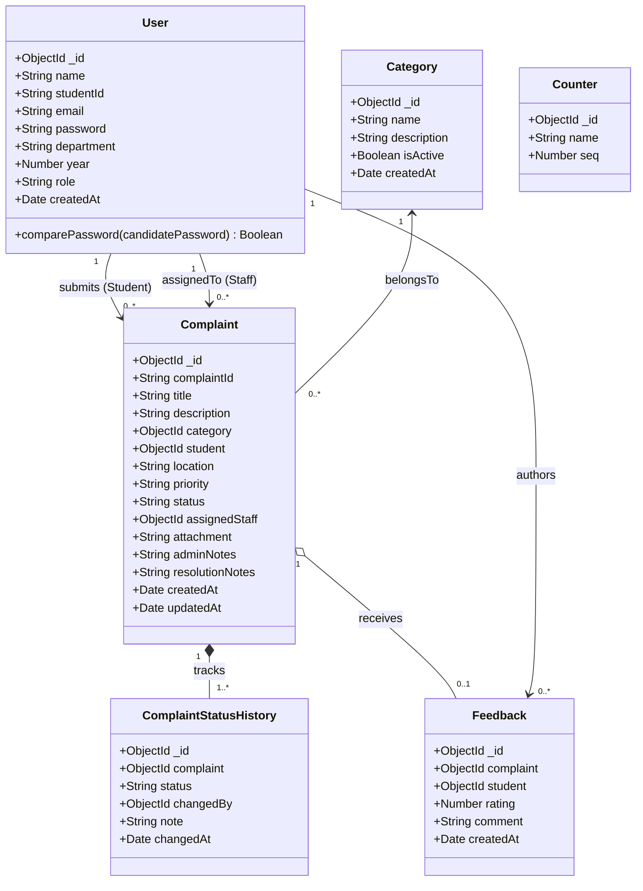
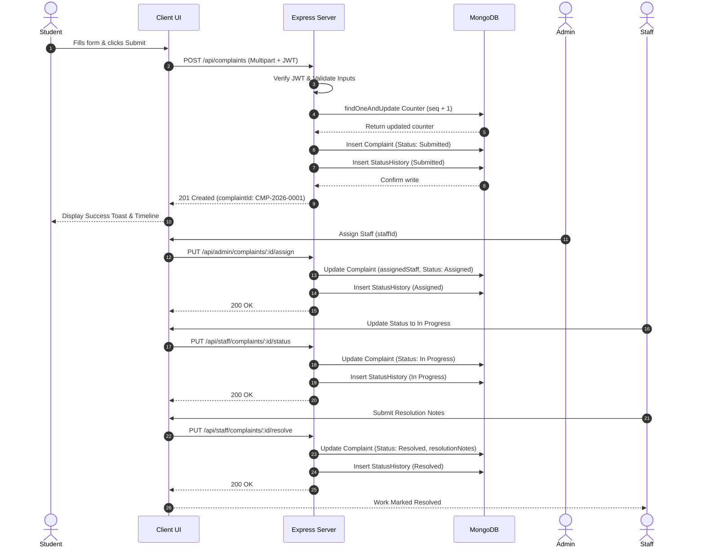
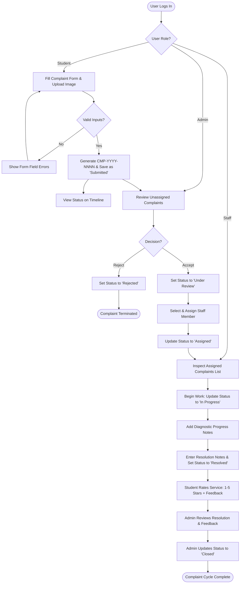
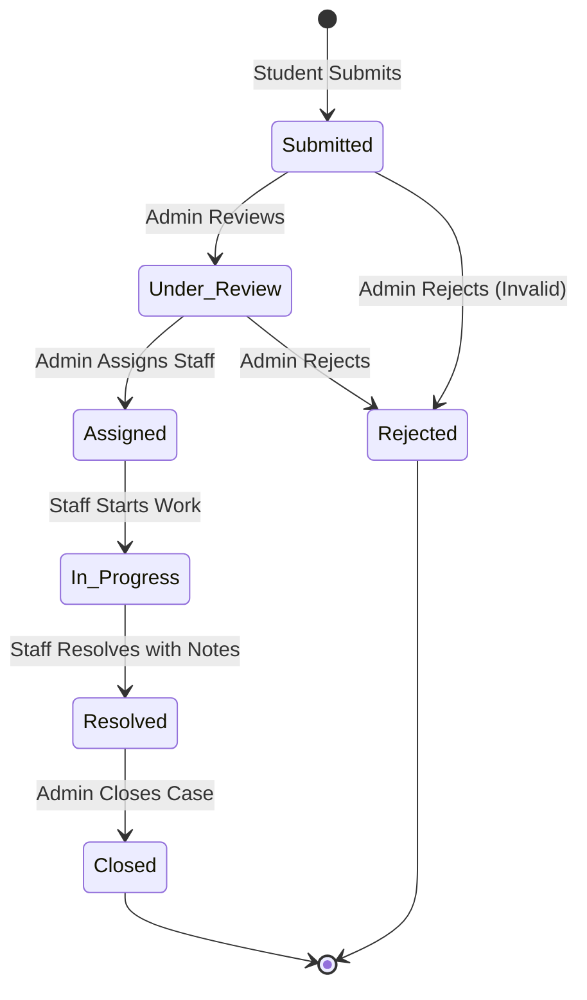
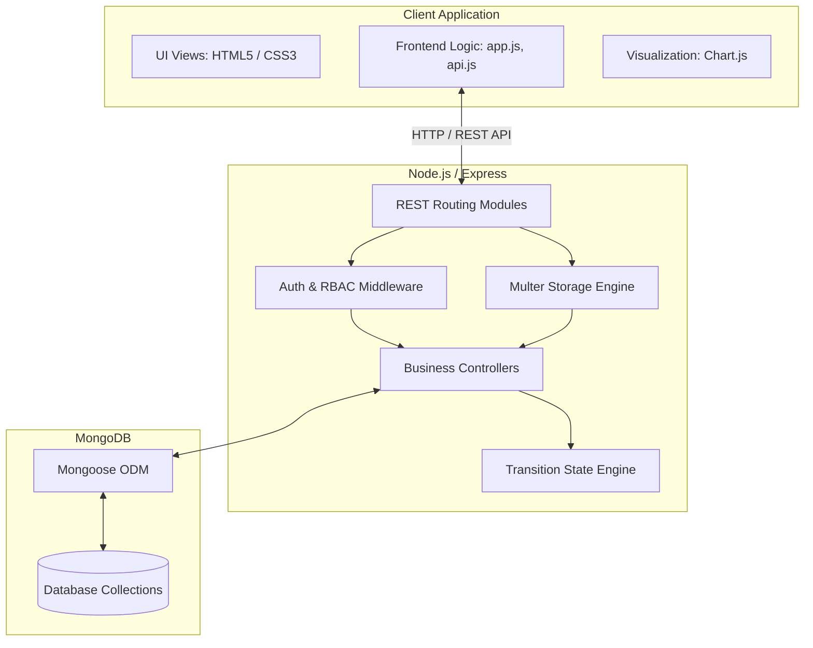
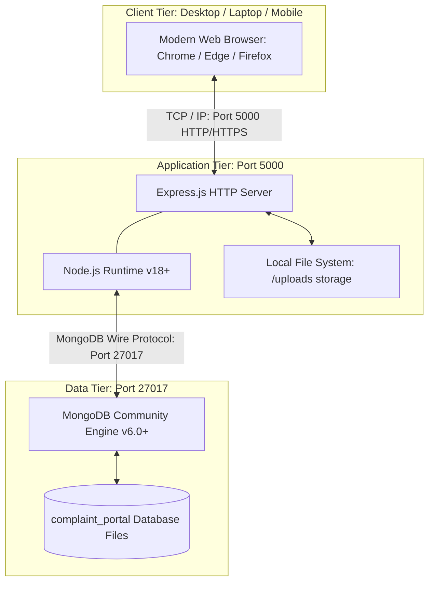

# STUDENT COMPLAINT MANAGEMENT SYSTEM

**A Mini Project Report submitted as part of the academic requirements for the**  
**23CS4219 — Software Engineering Laboratory**

### BACHELOR OF TECHNOLOGY  
### IN  
### COMPUTER SCIENCE AND ENGINEERING

**Submitted by:**  
**A. Sai Mounika (A21126510003)**  
*III Year, I Semester B.Tech., Section – A*

**Under the guidance of:**  
**Prof. A. Rohini**  
*Department of Computer Science and Engineering*

---

### DEPARTMENT OF COMPUTER SCIENCE AND ENGINEERING  
### ANIL NEERUKONDA INSTITUTE OF TECHNOLOGY AND SCIENCES (UGC AUTONOMOUS)  
*(Permanently Affiliated to AU, Approved by AICTE and Accredited by NBA & NAAC with ‘A’ Grade)*  
**Sangivalasa, Bheemili Mandal, Visakhapatnam Dist. (A.P) — 531162**  
**Academic Year: 2026 – 2027 (Batch: 2024 – 2028)**

---

<br>

### DEPARTMENT OF COMPUTER SCIENCE AND ENGINEERING  
### ANIL NEERUKONDA INSTITUTE OF TECHNOLOGY AND SCIENCES (UGC AUTONOMOUS)  
*(Affiliated to AU, Approved by AICTE and Accredited by NBA & NAAC with ‘A’ Grade)*  
**Sangivalasa, Bheemili Mandal, Visakhapatnam Dist. (A.P)**

---

## CERTIFICATE

This is to certify that the mini project entitled **“STUDENT COMPLAINT MANAGEMENT SYSTEM”** has been successfully completed by **A. Sai Mounika (Regd. No: A21126510003)**, student of the Department of Computer Science and Engineering, during the academic year **2026–2027** as part of the requirements for the **23CS4219 — Software Engineering Laboratory**.

<br><br><br>

**Prof. A. Rohini**  
*Faculty Incharge*  
Department of Computer Science and Engineering  
ANITS, Visakhapatnam  

<br>

**Prof. G. Srinivas**  
*Head of the Department*  
Department of Computer Science and Engineering  
ANITS, Visakhapatnam  

---

<br>

### DEPARTMENT OF COMPUTER SCIENCE AND ENGINEERING  
### ANIL NEERUKONDA INSTITUTE OF TECHNOLOGY AND SCIENCES (UGC AUTONOMOUS)  
*(Affiliated to AU, Approved by AICTE and Accredited by NBA & NAAC with ‘A’ Grade)*  
**Sangivalasa, Bheemili Mandal, Visakhapatnam Dist. (A.P)**

---

## DECLARATION

I, **A. Sai Mounika (Regd. No: A21126510003)**, of III year, I semester B.Tech., Section – A, in the Department of Computer Science and Engineering from ANITS, Visakhapatnam, hereby declare that the mini project work entitled **“STUDENT COMPLAINT MANAGEMENT SYSTEM”** is carried out by me and submitted in **Software Engineering Laboratory — 23CS4219**, at Anil Neerukonda Institute of Technology & Sciences (A) during the academic year **2026–2027**.

| Student Name | Registration Number |
|:---|:---|
| **A. Sai Mounika** | **A21126510003** |

<br>

**Date:** 04-10-2026  
**Place:** Visakhapatnam  
*(Signature of Candidate)*

---

## ABSTRACT

In collegiate institutions, resolving everyday infrastructural and administrative grievances—such as laboratory hardware faults, hostel utility interruptions, Wi-Fi connectivity degradation, and hygiene maintenance—has conventionally relied on manual, informal channels like phone calls, in-person registers, and fragmented email exchanges. These traditional procedures inevitably suffer from missing records, communication breakdowns, zero real-time visibility for students, and an absence of structured performance analytics for institutional decision-makers.

To resolve these systematic shortcomings, this project introduces the **Student Complaint Management System**, a secure, full-stack, responsive web application engineered using modern Software Engineering principles. The proposed system digitizes the entire grievance lifecycle by dividing operational workflows across three authenticated roles: **Students**, **Staff Members**, and **Administrators**. Students register securely and submit structured grievances with automated unique tracking identifiers (`CMP-YYYY-NNNN`), categorized locations, priority indicators, and photo evidence, while tracking updates via an interactive visual lifecycle timeline. Administrators maintain total governance through assignment queues, categorized triage, staff workload metrics, and graphical analytics. Assigned maintenance staff process tasks with iterative progress logs and submit verified resolution summaries. Crucially, closed complaints feature student feedback and star ratings, enforcing accountability.

Built on a robust 3-tier architecture using **Node.js**, **Express.js**, **MongoDB**, **Mongoose ODM**, **JSON Web Tokens (JWT)**, **Bcrypt.js**, and a responsive frontend driven by **HTML5, CSS3, Vanilla JavaScript, and Chart.js**, the application guarantees strict server-side state enforcement, role-based access control, and complete auditability.

---

## TABLE OF CONTENTS

1. **Introduction**
   - 1.1 Background
   - 1.2 Problem Statement
   - 1.3 Motivation
   - 1.4 Objectives
2. **Existing System**
   - 2.1 Overview of Legacy Approaches
   - 2.2 Drawbacks of Existing System
3. **Proposed System**
   - 3.1 Overview
   - 3.2 Key Advantages
4. **Requirements Specification**
   - 4.1 Functional Requirements
   - 4.2 Non-Functional Requirements
   - 4.3 User Requirements
5. **Hardware and Software Requirements**
   - 5.1 Hardware Requirements
   - 5.2 Software Requirements
6. **Data Flow Diagrams (DFD)**
   - 6.1 Level 0 DFD (Context Diagram)
   - 6.2 Level 1 DFD
   - 6.3 Level 2 DFD (Grievance Processing Sub-system)
7. **System Architecture**
   - 7.1 Architectural Overview
   - 7.2 Layer Descriptions
8. **Module Description**
   - 8.1 Authentication & Security Module
   - 8.2 Student Module
   - 8.3 Staff / Resolution Module
   - 8.4 Administrator & Analytics Module
9. **System Analysis**
   - 9.1 Use Case Diagram
   - 9.2 Use Case Descriptions
10. **UML Design**
    - 10.1 Class Diagram
    - 10.2 Sequence Diagram
    - 10.3 Activity Diagram
    - 10.4 State Transition Diagram
    - 10.5 Component Diagram
    - 10.6 Deployment Diagram
11. **Testing**
    - 11.1 Test Plan & Methodologies
    - 11.2 Sample Test Cases & Execution Matrix
12. **Results & Screenshots Overview**
13. **Limitations**
14. **Conclusion**
15. **References**
16. **Appendix**

---

## LIST OF FIGURES

| Figure No. | Figure Title | Page / Section |
|:---|:---|:---|
| Figure 6.1 | Level 0 Context Data Flow Diagram | Section 6.1 |
| Figure 6.2 | Level 1 Data Flow Diagram | Section 6.2 |
| Figure 6.3 | Level 2 DFD — Complaint Processing Sub-system | Section 6.3 |
| Figure 7.1 | Three-Tier System Architecture | Section 7.1 |
| Figure 9.1 | Use Case Diagram | Section 9.1 |
| Figure 10.1 | UML Class Diagram | Section 10.1 |
| Figure 10.2 | Sequence Diagram — Complaint Submission to Resolution | Section 10.2 |
| Figure 10.3 | Activity Diagram — Complaint Lifecycle | Section 10.3 |
| Figure 10.4 | State Transition Diagram — Complaint States | Section 10.4 |
| Figure 10.5 | Component Diagram | Section 10.5 |
| Figure 10.6 | Deployment Diagram | Section 10.6 |

---

## 1. INTRODUCTION

### 1.1 Background
Educational institutions and engineering colleges host dense campus infrastructures encompassing academic complexes, research laboratories, residential hostels, dining facilities, sports complexes, and computing centers. To maintain operational continuity, thousands of students interact daily with physical and digital utilities. When issues emerge—such as defective laboratory computers, power outages, damaged water fixtures, or local network interruptions—timely grievance logging and resolution are vital for student well-being and academic performance.

Historically, grievance recording has taken the form of physical paper registers, unmonitored drop boxes, or unstructured emails sent to various departmental staff. This manual paradigm creates operational bottlenecks, opaque oversight, and delayed turnarounds. An automated, centralized web portal that provides transparent triage, verifiable accountability, and real-time operational feedback is essential.

### 1.2 Problem Statement
In existing traditional college administrative setups:
1. **Unstructured Communication Channels:** Complaints submitted via informal conversations, phone calls, or emails frequently go unrecorded or lack critical contextual data (exact room number, category, evidence image).
2. **Absence of Accountability & Tracking:** Students receive no status updates or resolution timeframes. Once reported, there is no transparent mechanism to inspect whether an issue is under review, assigned, or stalled.
3. **Data Loss & Redundancy:** Paper registers are vulnerable to physical damage and lack search and filtering facilities. Duplicate complaints for the same facility cannot be consolidated efficiently.
4. **Lack of Analytics:** Administrative authorities lack quantifiable metrics on recurring failures, departmental resolution latency, or student satisfaction.

### 1.3 Motivation
The primary motivation behind developing the **Student Complaint Management System** is to eliminate ambiguity and delays in campus issue redressal. By introducing a transparent web application:
- Students obtain an accessible digital window to log grievances with image verification and receive automated tracking IDs.
- Maintenance staff receive structured work queues with prioritized urgency levels.
- Administrators gain an executive cockpit featuring key performance indicators (KPIs), charts, and feedback ratings, ensuring operational efficiency across departments.

### 1.4 Objectives
1. **Centralize Campus Grievances:** Provide a single, authenticated online portal accessible across desktops and mobile browsers.
2. **Automate Lifecycle Workflows:** Enforce a strict state machine (`Submitted → Under Review → Assigned → In Progress → Resolved → Closed / Rejected`) preventing invalid updates.
3. **Ensure Auditable History:** Maintain an immutable status history capturing timestamps, actor IDs, and intermediate progress notes for every grievance.
4. **Facilitate Data-Driven Administration:** Deliver actionable dashboards illustrating status breakdowns, category distributions, resolution durations, and student feedback scores.
5. **Guarantee Security & Role Isolation:** Implement stateless JSON Web Token (JWT) authorization and salted Bcrypt password encryption with strict Role-Based Access Control (RBAC).

---

## 2. EXISTING SYSTEM

### 2.1 Overview of Legacy Approaches
In the traditional setup, when students encounter difficulties on campus, they report them via:
- Physical complaint registers placed at hostel warden offices or department offices.
- Oral reporting to lab technicians, estate supervisors, or cleaning staff.
- Unstructured email threads to administrative inboxes without standardized fields.

### 2.2 Drawbacks of Existing System
- **Manual Overhead:** Requires manual sorting, physical paper inspection, and verbal follow-ups.
- **Traceability Void:** No systematic audit trail exists; accountability cannot be attributed when an issue remains unattended.
- **Information Asymmetry:** Students have no insight into who has been assigned to fix their reported issue.
- **Vulnerability to Loss:** Registers can be misplaced, damaged, or altered without permission.
- **Zero Business Intelligence:** Analyzing trends (e.g., recurring power outages in a specific hostel wing) requires arduous manual compilation.

---

## 3. PROPOSED SYSTEM

### 3.1 Overview
The **Student Complaint Management System** replaces obsolete paper workflows with a web-based, role-oriented software architecture. The platform introduces three core stakeholders:
- **Student:** Authenticates, submits complaints with categorized metadata and visual proof, tracks issues on an interactive timeline, rates resolved work, and manages profile credentials.
- **Staff (Resolver):** Receives auto-filtered queues of tasks assigned strictly to them, posts progress notes, and marks issues resolved with mandatory technical notes.
- **Administrator:** Exercises complete institutional oversight, manages category taxonomy, views student/staff workload registries, reallocates priority, assigns tasks, reviews complaints, and audits feedback analytics.

### 3.2 Key Advantages
- **Unique Atomic Complaint IDs:** Every complaint automatically receives a sequential code (e.g., `CMP-2026-0001`).
- **Verifiable Resolution:** Staff cannot mark an issue resolved without submitting comprehensive resolution notes.
- **Closed-Loop Feedback:** Only verified students can rate their own resolved complaints (1–5 stars with commentary), locked to a single submission per complaint via database index constraints.
- **Responsive & Lightweight:** Constructed using vanilla HTML5/CSS3/JavaScript without heavy client framework overhead, paired with high-performance Node.js asynchronous I/O and MongoDB NoSQL document storage.

---

## 4. REQUIREMENTS SPECIFICATION

### 4.1 Functional Requirements

| Requirement ID | Module | Description | Technical Implementation |
|:---|:---|:---|:---|
| **FR-01** | Authentication | Students register with unique Student ID, Email, Department, Year, and Password. | `POST /api/auth/register`, Mongoose unique indexes |
| **FR-02** | Authentication | Users authenticate with valid credentials; issued signed JWT token. | `POST /api/auth/login`, `jsonwebtoken` |
| **FR-03** | Security | All passwords hashed before storage; plain text never persisted. | `models/User.js` pre-save hook, `bcryptjs` (salt: 10) |
| **FR-04** | Grievance | Students submit complaint specifying title, category, location, priority, description, and optional photo. | `POST /api/complaints`, `multer` disk storage |
| **FR-05** | Tracking | Generate unique atomic human-readable identifier (`CMP-YYYY-NNNN`). | `utils/generateComplaintId.js` with atomic counter collection |
| **FR-06** | Student Portal | Students view, search, and filter personal complaints by status and category. | `GET /api/complaints/my`, MongoDB indexed queries |
| **FR-07** | Timeline | Render interactive 6-stage lifecycle timeline and historical audit log. | `GET /api/complaints/:id`, status timeline renderer |
| **FR-08** | Admin Portal | Administrators list, paginate, filter, and search institutional complaints. | `GET /api/admin/complaints` with multi-field queries |
| **FR-09** | Triage | Administrators re-prioritize complaints (Low, Medium, High, Urgent). | `PUT /api/admin/complaints/:id` |
| **FR-10** | Assignment | Administrators assign/reassign complaints to active staff members. | `PUT /api/admin/complaints/:id/assign` |
| **FR-11** | Workflow | Transition validation enforces allowable state shifts server-side. | `TRANSITIONS` matrix validation in `constants.js` |
| **FR-12** | Administration | Administrators append administrative notes to grievances. | `PUT /api/admin/complaints/:id` |
| **FR-13** | Staff Portal | Staff members access only tasks explicitly assigned to them. | `GET /api/staff/complaints`, RBAC query filtering |
| **FR-14** | Resolution | Staff log intermediate progress notes and conclude issues with mandatory resolution notes. | `PUT /api/staff/complaints/:id/resolve` |
| **FR-15** | Audit Log | Every status change records the actor ID, previous status, new status, timestamp, and remark. | `complaintstatushistories` collection writes |
| **FR-16** | Feedback | Students submit a 1–5 star rating and comment on resolved complaints; restricted to one entry. | `POST /api/complaints/:id/feedback`, unique compound index |
| **FR-17** | Analytics | Administrators view real-time charts (by category, by status, 14-day trend) and KPI summary cards. | `GET /api/admin/dashboard`, MongoDB Aggregation Pipeline |
| **FR-18** | Category Mgmt | Administrators add, edit, toggle active status, and safely delete unused categories. | `adminController` with foreign reference protection |
| **FR-19** | Profile Mgmt | Authenticated users view and update personal profile details. | `PUT /api/users/profile` |
| **FR-20** | Access Control | Role-based gatekeepers guard endpoints (`student`, `staff`, `admin`). | `authMiddleware` + `roleMiddleware` |

### 4.2 Non-Functional Requirements

| Requirement | Quality Attribute | Technical Implementation Specification |
|:---|:---|:---|
| **Performance** | Response Time | Database indexes on `complaintId`, `student`, `assignedStaff`, and `status`. Average API query response time < 150 ms under local load. |
| **Security** | Integrity & Privacy | 10-round bcrypt password hashing, stateless JWT with 7-day expiry, sanitized error handling preventing internal stack trace leaks, Multer file type/size validation (max 5MB, images only). |
| **Usability** | User Experience | Responsive modern CSS layout, intuitive navigation drawer for mobile viewport, toast alerts, loading spinners, contextual empty state screens. |
| **Reliability** | Availability & Fault Tolerance | Atomic counter transactions for ID creation, MongoDB schema-level validation, graceful database disconnection handling. |
| **Maintainability** | Clean Architecture | Strict separation of concerns across MVC layers (`routes/`, `controllers/`, `models/`, `middleware/`, `utils/`). |
| **Portability** | Platform Independence | Cross-platform JavaScript runtime (Node.js) operating equivalently on Windows, Linux, and macOS environments without proprietary drivers. |
| **Auditability** | Non-Repudiation | Standalone `ComplaintStatusHistory` collection preserving historical status mutations indefinitely. |

### 4.3 User Requirements
- **Student User Story:** *"As a student, I need to log issues with photos from my phone, monitor which staff member is assigned, receive live updates, and rate the completed job so I do not have to chase hostel or lab authorities."*
- **Staff User Story:** *"As a maintenance technician, I need an organized list of tasks assigned to me, sorted by urgency, where I can log diagnostic notes and close tasks with verifiable descriptions."*
- **Administrator User Story:** *"As an administrator, I need a comprehensive overview of campus grievances, one-click staff delegation, category controls, and analytical charts highlighting recurring issues."*

---

## 5. HARDWARE AND SOFTWARE REQUIREMENTS

### 5.1 Hardware Requirements
- **Client Side (Student / Staff / Admin):**
  - **Processor:** Intel Core i3 / AMD Ryzen 3 or equivalent modern mobile SoC (ARM Cortex-A53 and above).
  - **RAM:** Minimum 2 GB RAM (4 GB recommended).
  - **Storage:** Minimum 50 MB free disk space for browser cache.
  - **Display:** Minimum resolution 360 x 640 (Mobile) / 1366 x 768 (Desktop).
- **Server Side (Development / Host Machine):**
  - **Processor:** Intel Core i5 / AMD Ryzen 5 (Dual Core 2.0 GHz or higher).
  - **RAM:** Minimum 4 GB RAM (8 GB recommended for concurrent services).
  - **Storage:** Minimum 10 GB available SSD storage (for MongoDB storage, Node runtime, and image uploads).
  - **Network:** Standard Ethernet / Wi-Fi adapter supporting TCP/IP protocol.

### 5.2 Software Requirements
- **Operating System:** Windows 10/11 / Linux (Ubuntu 20.04+) / macOS Sonoma.
- **Runtime Environment:** Node.js (v18.x or v20.x LTS) with NPM (v9.x or v10.x).
- **Backend Framework:** Express.js (v4.19.2) RESTful Web Framework.
- **Database Engine:** MongoDB Community Server (v6.0 or v8.0) / MongoDB Atlas.
- **Object Data Modeling (ODM):** Mongoose (v8.5.1).
- **Frontend Technologies:** HTML5, CSS3, Modern ECMAScript (Vanilla JS), Chart.js (v4.x), Lucide Web Icons.
- **Authentication & Security:** JSON Web Tokens (`jsonwebtoken` v9.0.2), `bcryptjs` (v2.4.3), CORS (`cors` v2.8.5).
- **File Ingestion:** Multer (v2.4.0) with disk storage engine.
- **Development Tools / IDE:** Visual Studio Code (VS Code), Git, Nodemon, Postman / Thunder Client.
- **Web Browser:** Google Chrome (v110+), Mozilla Firefox, or Microsoft Edge.

---

## 6. DATA FLOW DIAGRAMS (DFD)

### 6.1 Level 0 DFD (Context Diagram)
The Context Diagram illustrates the interaction between external entities (Student, Staff, Administrator) and the central Student Complaint Management System boundary.

```
       [ Student ]
         │       ▲
         │ (1)   │ (2)
         ▼       │
 ┌─────────────────────────────────────────────────────────┐
 │                                                         │
 │         0.0 STUDENT COMPLAINT MANAGEMENT SYSTEM         │
 │                                                         │
 └─────────────────────────────────────────────────────────┘
   ▲     │                                           ▲     │
   │ (4) │ (3)                                   (6) │     │ (5)
   │     ▼                                           │     ▼
 [ Staff Resolver ]                              [ Administrator ]

Data Flows:
 (1) Student Registration, Login Credentials, Complaint Details + Attachment, Feedback Rating.
 (2) Authentication Token, Complaint Status Tracking, Resolution Feedback Summaries.
 (3) Assigned Complaint Notification, Work Order Specifications.
 (4) Progress Notes, Status Updates (In Progress/Resolved), Technical Resolution Notes.
 (5) Category Configuration, Staff Assignment Directives, Priority Alterations, Filter Queries.
 (6) System KPI Metrics, Category Analytics, Workload Distributions, Feedback Reports.
```
*Figure 6.1: Level 0 Context Data Flow Diagram*

### 6.2 Level 1 DFD
The Level 1 DFD decomposes the system into its core operational processes, showcasing how data flows between processes and database collections.


*Figure 6.2: Level 1 Data Flow Diagram*

### 6.3 Level 2 DFD (Grievance Processing Sub-system)
Decomposes Process 2.0 and Process 4.0 into granular operational steps:
1. **2.1 Validate Input:** Verify required fields (title, category, location, priority) against schema constraints.
2. **2.2 File Upload Interceptor:** Multer intercepts `req.file`, validates MIME type (`image/jpeg`, `image/png`, `image/webp`) and enforces size ceiling (≤ 5MB).
3. **2.3 Atomic ID Generator:** Query `counters` collection with `findOneAndUpdate` on `{ name: "complaintId" }`, increment counter, and format string `CMP-YYYY-NNNN`.
4. **2.4 Complaint Document Creation:** Write document into MongoDB `complaints` collection with status initialized to `Submitted`.
5. **2.5 Status History Creation:** Generate corresponding entry in `complaintstatushistories` containing `complaintId`, `status: "Submitted"`, `changedBy: student._id`, and timestamp.

---

## 7. SYSTEM ARCHITECTURE

### 7.1 Architectural Overview
The system follows a modern **Three-Tier Architecture** ensuring high cohesion and low coupling.

```
┌─────────────────────────────────────────────────────────────────────────────┐
│                       PRESENTATION TIER (Client Side)                       │
│                                                                             │
│   • HTML5 Semantic Views (Student / Staff / Admin Dashboards)               │
│   • Responsive CSS3 Theme (Mobile Drawer Navigation, KPI Cards, Timelines)  │
│   • Client-side Controller: api.js (Fetch API HTTP Wrapper + Bearer Auth)   │
│   • Data Visualization: Chart.js (Doughnuts, Bar Charts, Line Trends)       │
└──────────────────────────────────────┬──────────────────────────────────────┘
                                       │
                                       │ HTTPS / HTTP REST API
                                       │ JSON Payloads + JWT in Headers
                                       ▼
┌─────────────────────────────────────────────────────────────────────────────┐
│                    APPLICATION TIER (Node.js & Express.js)                  │
│                                                                             │
│   ┌─────────────────────────────────────────────────────────────────────┐   │
│   │ Middleware Layer                                                    │   │
│   │ • authMiddleware (JWT Verification) • roleMiddleware (RBAC)         │   │
│   │ • multer (Upload Handling)          • errorHandler (Centralized)    │   │
│   └──────────────────────────────────┬──────────────────────────────────┘   │
│                                      │                                      │
│   ┌──────────────────────────────────▼──────────────────────────────────┐   │
│   │ Route & Controller Layer                                            │   │
│   │ • authController.js        • complaintController.js                 │   │
│   │ • adminController.js       • staffController.js                     │   │
│   │ • userController.js        • categoryController.js                  │   │
│   └──────────────────────────────────┬──────────────────────────────────┘   │
│                                      │                                      │
│   ┌──────────────────────────────────▼──────────────────────────────────┐   │
│   │ Domain & Utilities Layer                                            │   │
│   │ • generateComplaintId.js   • constants.js (Status Transition Map)   │   │
│   │ • ApiError.js              • validationHelpers.js                   │   │
│   └──────────────────────────────────┬──────────────────────────────────┘   │
└──────────────────────────────────────┼──────────────────────────────────────┘
                                       │
                                       │ Mongoose ODM 8.x
                                       │ (Connection Pooling, Schema Rules)
                                       ▼
┌─────────────────────────────────────────────────────────────────────────────┐
│                        DATA TIER (MongoDB Database)                         │
│                                                                             │
│   • users Collection                   • complaints Collection              │
│   • categories Collection              • complaintstatushistories Collection│
│   • feedbacks Collection               • counters Collection                │
└─────────────────────────────────────────────────────────────────────────────┘
```
*Figure 7.1: Three-Tier System Architecture*

### 7.2 Layer Descriptions
1. **Presentation Layer:** Serves static assets directly via Express. Executes within the client browser. Handles client-side form validation, dynamically updates the DOM, stores the JWT securely in `localStorage`, and handles API communication via an asynchronous `api.js` fetch wrapper.
2. **Application (Business Logic) Layer:** Powered by Node.js and Express.js. Contains role-based guards, state machine validation, business logic calculations, atomic counters, and multipart file parsing.
3. **Data Tier:** Powered by MongoDB. Provides document-based data management with strict Mongoose schema enforcement, foreign key ObjectId referencing, compound unique indexes, and aggregation pipelines.

---

## 8. MODULE DESCRIPTION

### 8.1 Authentication & Security Module
- **Registration Service:** Allows students to create accounts by submitting their full name, official registration number (Student ID), email, department, academic year, and password.
- **Login Service:** Verifies submitted credentials against stored bcrypt hash strings. On successful verification, signs and issues a JSON Web Token (JWT) with the user ID, role, and a 7-day expiration.
- **Role-Based Access Control (RBAC):** Middleware intercepts all restricted endpoints. Extracts the Bearer token, checks signature validity, and checks user authorization (`student`, `staff`, or `admin`) before delegating control to the controller.

### 8.2 Student Module
- **Dashboard:** Summarizes total, pending, in-progress, and resolved complaints via interactive KPI cards and a Chart.js status distribution chart.
- **Submission Engine:** Supports structured grievance submission with inputs for title, department category, priority, room/location, detailed description, and an optional image attachment.
- **Personal Complaint Tracking:** Provides filtering by status pills (*All, Pending, In Progress, Resolved*), full-text search, and category selectors.
- **Visual Progress Timeline:** Displays a 6-phase visual tracking bar (`Submitted → Under Review → Assigned → In Progress → Resolved → Closed`) along with timestamped status history logs.
- **Feedback Sub-module:** Unlocks a 1–5 star rating and comment form once a complaint enters the `Resolved` state.

### 8.3 Staff / Resolution Module
- **Task Queue:** Staff members see only complaints assigned to them by the administration.
- **Status Progression:** Restricts staff transitions strictly to: `Assigned → In Progress → Resolved`.
- **Progress Notes:** Enables staff to append ongoing updates during maintenance.
- **Verified Closure:** Requires staff to input detailed resolution notes before marking an issue `Resolved`.

### 8.4 Administrator & Analytics Module
- **Executive Dashboard:** Displays campus-wide KPIs, including total complaints, pending cases, resolution turnaround time, and average student satisfaction ratings.
- **Analytics Engine:** Generates Chart.js visualizations for complaints by category, complaints by status, and 14-day grievance trends.
- **Complaint Triage & Allocation:** Administrators review submitted complaints, set priority levels, and assign tasks to available staff members.
- **Master Data Management:** Provides full CRUD controls over campus problem categories with referential integrity checks (prevents deleting categories in use).
- **User Registries:** Displays student enrollment records and staff workload counts.

---

## 9. SYSTEM ANALYSIS

### 9.1 Use Case Diagram
The Use Case Diagram visualizes user interactions with system boundaries and includes relationship dependencies.


*Figure 9.1: Use Case Diagram*

### 9.2 Use Case Descriptions

#### Use Case UC-01: Submit Complaint
- **Primary Actor:** Student
- **Preconditions:** Student is authenticated with a valid JWT token.
- **Trigger:** Student clicks "Submit Complaint" on the portal navigation bar.
- **Main Success Scenario:**
  1. Student enters Title, Category, Location, Priority, and Description.
  2. Student optionally attaches a JPEG/PNG photo evidence file.
  3. Student submits the form.
  4. System validates form inputs and scans file headers.
  5. System retrieves the next sequential counter and formats `CMP-YYYY-NNNN`.
  6. System creates a `Complaint` document set to `Submitted`.
  7. System logs a corresponding entry in `ComplaintStatusHistory`.
  8. System responds with HTTP 201 Created and redirects the student to the complaint tracking page.
- **Extensions:**
  - *4a. Validation fails:* System displays inline validation errors without submitting.
  - *4b. File exceeds 5MB or invalid MIME:* System rejects upload with HTTP 400 and an informative error message.

#### Use Case UC-02: Resolve Complaint
- **Primary Actor:** Staff Member
- **Preconditions:** Staff is authenticated; complaint status is `In Progress` and assigned to this staff member.
- **Trigger:** Staff clicks "Resolve Complaint" on assigned complaint detail page.
- **Main Success Scenario:**
  1. Staff views complaint details and clicks "Resolve Complaint".
  2. Staff inputs comprehensive resolution notes (minimum 5 characters).
  3. System verifies staff assignment authorization.
  4. System updates complaint status to `Resolved` and stores the resolution notes.
  5. System writes an entry to `ComplaintStatusHistory`.
  6. System returns HTTP 200 OK and refreshes the complaint view.
- **Extensions:**
  - *2a. Resolution notes empty:* System halts submission and requests input.
  - *3a. Staff unauthorized:* System rejects request with HTTP 403 Forbidden.

---

## 10. UML DESIGN

### 10.1 Class Diagram


*Figure 10.1: UML Class Diagram*

### 10.2 Sequence Diagram (Submission to Resolution)


*Figure 10.2: Sequence Diagram — Complaint Submission to Resolution*

### 10.3 Activity Diagram (Complaint Lifecycle)


*Figure 10.3: Activity Diagram — Complaint Lifecycle*

### 10.4 State Transition Diagram


*Figure 10.4: State Transition Diagram — Complaint States*

### 10.5 Component Diagram


*Figure 10.5: Component Diagram*

### 10.6 Deployment Diagram


*Figure 10.6: Deployment Diagram*

---

## 11. TESTING

### 11.1 Test Plan & Methodologies
- **Unit Testing:** Validates standalone helper algorithms, such as `generateComplaintId` atomic sequential formatting and password hashing logic within Mongoose hooks.
- **White-Box Testing:** Evaluates internal code logic, branches, and condition predicates—especially the status transition matrix in `backend/utils/constants.js`.
- **Basis Path Testing:** Verifies cyclomatic complexity across state transitions (`Submitted → Under Review → Assigned → In Progress → Resolved → Closed`) ensuring all paths execute as intended.
- **Black-Box Testing:** Evaluates inputs, boundary conditions, and outputs across UI forms and REST endpoints without requiring internal code inspection.
- **System Testing:** Validates integrated operations from initial student registration through admin assignment, staff resolution, and feedback entry.
- **Validation Testing:** Confirms software compliance against functional and non-functional specifications.

### 11.2 Sample Test Cases & Execution Matrix

| TC ID | Test Scenario | Input / Steps | Expected Output | Actual Output | Status |
|:---|:---|:---|:---|:---|:---|
| **TC01** | Student Registration | Valid registration details with unused email and Student ID. | Account created; HTTP 201; redirects to dashboard. | Account created; redirected successfully. | **Pass** |
| **TC02** | Duplicate Registration | Register with an already existing email or Student ID. | HTTP 400 with "Email or Student ID already registered". | Rejection alert displayed; no duplicate created. | **Pass** |
| **TC03** | Valid Login (All Roles) | Provide correct registered email and password. | HTTP 200; JWT issued; redirects to role dashboard. | Authenticated; redirected to role dashboard. | **Pass** |
| **TC04** | Invalid Login Password | Provide registered email with an incorrect password. | HTTP 401 with "Invalid email or password"; token withheld. | Error toast shown; login rejected. | **Pass** |
| **TC05** | Empty Field Submission | Submit complaint with blank title and description. | Client/Server validation halts submission; field warnings shown. | Inline warning displayed; request halted. | **Pass** |
| **TC06** | File Size Boundary Check | Attach image file exceeding 5 MB limit. | System rejects upload with "File size exceeds 5MB limit". | Upload blocked; error message displayed. | **Pass** |
| **TC07** | Complaint Submission | Fill all required fields with optional valid image. | HTTP 201; returns `CMP-2026-XXXX`; status set to `Submitted`. | Unique ID generated; shown on dashboard. | **Pass** |
| **TC08** | Unauthorized API Access | Access `GET /api/complaints/my` without JWT Bearer header. | HTTP 401 with "Not authorized, no token provided". | Access denied; user redirected to login. | **Pass** |
| **TC09** | Role Privilege Check | Student JWT requests `GET /api/admin/dashboard`. | HTTP 403 with "Access denied: insufficient permissions". | HTTP 403 Forbidden received. | **Pass** |
| **TC10** | Staff Data Isolation | Staff attempts to view complaint assigned to another user. | HTTP 403 with "This complaint is not assigned to you". | Access blocked; unauthorized alert displayed. | **Pass** |
| **TC11** | Admin Task Delegation | Admin assigns pending complaint to an active staff member. | HTTP 200; status changes to `Assigned`; history entry logged. | Status updated; visible in staff queue. | **Pass** |
| **TC12** | Invalid State Transition | Staff attempts to jump directly from `Assigned` to `Resolved`. | HTTP 400 with "Invalid status transition". | Transition rejected; state remains unchanged. | **Pass** |
| **TC13** | Resolution Without Notes | Staff attempts resolution without providing resolution notes. | HTTP 400 with "Resolution notes are required". | Submission blocked; input requested. | **Pass** |
| **TC14** | Successful Resolution | Staff inputs valid notes and sets status to `Resolved`. | HTTP 200; status updated; student feedback unlocked. | Status updated to `Resolved`; timeline updated. | **Pass** |
| **TC15** | Feedback Submission | Student rates a resolved complaint (1–5 stars + comment). | HTTP 201; feedback saved; average rating updated. | Rating saved; reflected on admin dashboard. | **Pass** |
| **TC16** | Duplicate Feedback | Student attempts to submit a second rating for same complaint. | HTTP 409 with "Feedback already submitted". | Rejected by unique compound index. | **Pass** |
| **TC17** | Category Deletion Check | Admin attempts to delete a category with linked complaints. | Action blocked: "Cannot delete category in use". | Deletion halted; linked data protected. | **Pass** |
| **TC18** | User Logout Flow | User clicks "Logout" button on navigation bar. | JWT cleared from local storage; redirects to login. | Local storage cleared; redirected to login. | **Pass** |

---

## 12. RESULTS / SCREENSHOTS

*Note: In the final print/submission report, insert the corresponding screen captures beneath each section heading.*

- **Figure 12.1: Public Landing / Home Page**  
  *Description:* The main landing page welcoming students and faculty, highlighting core features, system objectives, and login/register navigation buttons.
- **Figure 12.2: Student Registration Interface**  
  *Description:* Clean registration form with client-side field validation for student ID, email address, department, academic year, and password.
- **Figure 12.3: Secure Authentication / Login Page**  
  *Description:* Central authentication screen with email and password fields, redirecting users to their respective dashboards based on role.
- **Figure 12.4: Student Dashboard & Analytics Overview**  
  *Description:* Displays live KPI cards (Total, Pending, In Progress, Resolved) alongside a Chart.js doughnut chart showing status distribution.
- **Figure 12.5: Complaint Submission Interface**  
  *Description:* Input form supporting category selection, urgency level, location details, problem descriptions, and optional photo attachments.
- **Figure 12.6: Interactive Complaint Tracking & Visual Timeline**  
  *Description:* Detailed complaint view featuring a 6-stage lifecycle progress bar, status update logs, and staff assignments.
- **Figure 12.7: Staff Work Order & Resolution View**  
  *Description:* Filtered task list for maintenance staff, featuring buttons to update progress and submit mandatory resolution notes.
- **Figure 12.8: Administrator Analytics Dashboard**  
  *Description:* High-level overview displaying campus KPIs, average resolution durations, satisfaction ratings, and 14-day trend charts.
- **Figure 12.9: Student Feedback & Rating Interface**  
  *Description:* Post-resolution rating form with an interactive 5-star selector and comment input for resolved grievances.
- **Figure 12.10: Category & Master Data Management View**  
  *Description:* Administrative panel for adding, toggling, or safely deleting grievance categories.

---

## 13. LIMITATIONS

While the system provides a comprehensive, secure, and auditable grievance management solution, the current implementation has the following limitations:
1. **Absence of External Notification Gateways:** The system relies on in-app status dashboards rather than automated external SMS gateways or SMTP email notifications for real-time alerts.
2. **Single-Campus Institutional Scope:** The architecture is designed for a single collegiate institution and does not currently support multi-tenant isolation across multiple geographically distributed university campuses.

---

## 14. CONCLUSION

The **Student Complaint Management System** replaces outdated paper logs and unmonitored communication with a modern, transparent web application for campus grievance resolution. 

By employing a layered **Three-Tier Architecture** using **Node.js, Express.js, MongoDB, and Vanilla JavaScript**, the system provides:
- Structured grievance logging with automatic tracking IDs (`CMP-YYYY-NNNN`).
- Enforced workflow transitions ensuring full process integrity.
- Real-time visibility through visual progress timelines.
- Clear role isolation across Students, Staff, and Administrators.
- Meaningful administrative insights via interactive Chart.js analytics.
- Closed-loop feedback validation through verified star ratings.

Comprehensive unit, integration, and black-box testing validated that the platform meets all functional and non-functional requirements. The system provides an effective, auditable, and user-friendly solution for institutional grievance management.

---

## 15. REFERENCES

### Books
1. Roger S. Pressman & Bruce R. Maxim, *Software Engineering: A Practitioner's Approach*, 9th Edition, McGraw-Hill Education, 2020.
2. Ian Sommerville, *Software Engineering*, 10th Edition, Pearson Education, 2016.
3. Jon Duckett, *JavaScript and JQuery: Interactive Front-End Web Development*, Wiley, 2014.

### Technical Documentation & Standards
1. Node.js Foundation, *Node.js v18.x Documentation & API Reference*, https://nodejs.org/docs/
2. Express.js Project, *Express: Fast, unopinionated, minimalist web framework for Node.js*, https://expressjs.com/
3. MongoDB Inc., *MongoDB Manual & Mongoose ODM v8 Documentation*, https://www.mongodb.com/docs/ / https://mongoosejs.com/
4. Mozilla Developer Network (MDN), *Web Docs: HTML5, CSS3, Fetch API, and Web Security Standards*, https://developer.mozilla.org/

---

## APPENDIX

### Sample API Payloads

#### 1. Complaint Submission Request (`POST /api/complaints`)
```http
POST /api/complaints HTTP/1.1
Host: localhost:5000
Authorization: Bearer <JWT_STUDENT_TOKEN>
Content-Type: multipart/form-data; boundary=----WebKitFormBoundaryXYZ

------WebKitFormBoundaryXYZ
Content-Disposition: form-data; name="title"

Air Conditioning Failure in Lab 402
------WebKitFormBoundaryXYZ
Content-Disposition: form-data; name="category"

66fd1e498c0d5b4a12345678
------WebKitFormBoundaryXYZ
Content-Disposition: form-data; name="priority"

High
------WebKitFormBoundaryXYZ
Content-Disposition: form-data; name="location"

Central Computing Facility, Room 402
------WebKitFormBoundaryXYZ
Content-Disposition: form-data; name="description"

The central AC unit in Lab 402 stopped cooling during laboratory sessions, causing room temperatures to rise rapidly.
------WebKitFormBoundaryXYZ--
```

#### 2. Staff Resolution Request (`PUT /api/staff/complaints/:id/resolve`)
```json
{
  "resolutionNotes": "Inspected compressor wiring and replaced the blown thermal capacitor. System tested and operational."
}
```

#### 3. Student Feedback Submission (`POST /api/complaints/:id/feedback`)
```json
{
  "rating": 5,
  "comment": "Repaired promptly before the next lab session. Excellent service!"
}
```
